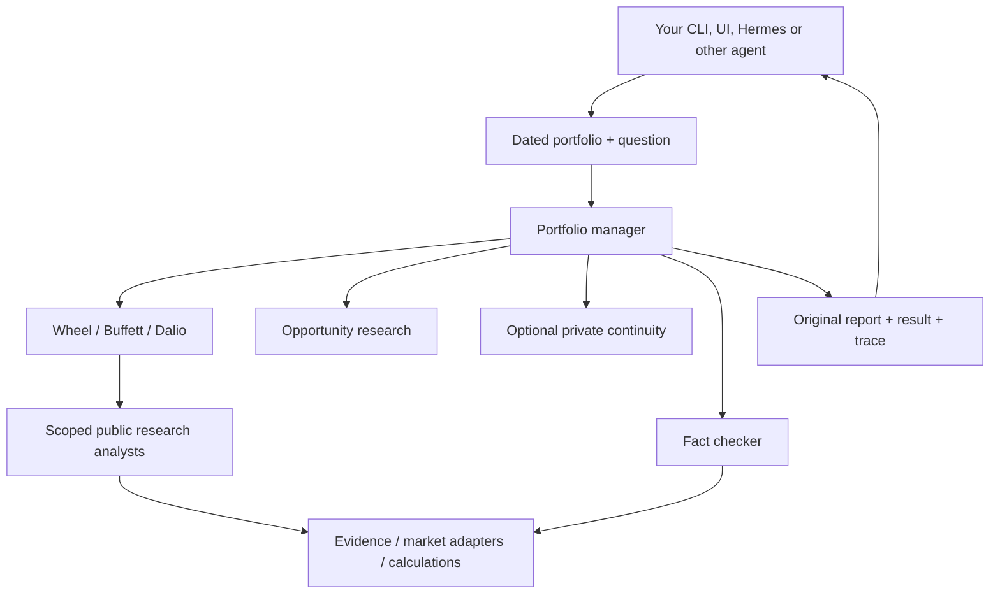

# Multi-agent Portfolio Management

A reusable Python runtime for portfolio research with [Strands Agents](https://github.com/strands-agents/sdk-python). A portfolio manager coordinates independent investment perspectives, public research, option mechanics, evidence, calculations and an author-directed fact checker. Models and prompt bundles are configurable.

This is an experimental advisory research system. A completed run is an execution status, not proof that its financial conclusions are correct. It does not place orders.

## What is included

- Portfolio manager, Wheel, Buffett-inspired and Dalio-inspired experts, analysts, Explorer, optional asymmetric research and file-based continuity.
- Markdown system prompts and financial knowledge with hash-bound manifests.
- Typed portfolio, evidence, tool and result contracts; decimal arithmetic and option scenarios.
- Local OpenAI-compatible model serving, per-expert model routing, bounded research adapters, recorded evidence and a local telemetry viewer.
- Synthetic fixtures, offline tests and an external-agent integration guide.

The named investment perspectives are simulations, with no affiliation or endorsement by the individuals named.

## Quickstart

Use Python 3.12+ and [uv](https://docs.astral.sh/uv/):

```bash
git clone https://github.com/krisitown/multiagent-portfolio-management.git
cd multiagent-portfolio-management
uv sync --locked
uv run wheel-team --help
uv run pytest tests/unit tests/contracts -q
```

Run a synthetic, network-free plumbing demonstration:

```bash
uv run python examples/offline_demo.py
```

For inference, start your chosen OpenAI-compatible server, then configure the runtime from environment variables:

```bash
cp .env.example .env
# Edit the non-secret defaults and add your own key. Do not commit .env.
set -a; . ./.env; set +a
uv run python scripts/configure.py --output .local/team-config.json
uv run wheel-team ask --mode combined \
  --question "Review this portfolio for options income and long-term wealth creation." \
  --portfolio-text "$PORTFOLIO_PATH" \
  --config .local/team-config.json --output "$RUN_OUTPUT_DIR"
```

The generated configuration selects the reusable council/checker/knowledge bundles. Supply your own dated portfolio input. Data providers are optional: without a connected backend, tools return explicit unavailable results. A model cannot turn those results into fresh evidence. See [configuration](docs/configuration.md) and [data-provider integration](docs/integration.md).

## Architecture



Hermes is an optional host/connector, not the runtime. Brokerage acquisition, credentials, account policies, schedules, notifications and trade execution belong to the integrating application. None of the original operator's account data or host deployment is included.

## Integrate or extend

- [Use this runtime from your agent](docs/integration.md)
- [Add an expert or tool](docs/extending.md)
- [Configuration and model compatibility](docs/configuration.md)
- [Validation and known limitations](docs/validation.md)
- [Instructions for coding agents](AGENTS.md)

## Optional model checkpoints

This runtime supports independently configured OpenAI-compatible endpoints. The companion **PortfolioFinQwen-27B** releases are available in two formats:

| Format | Model and benchmark card | Weight/config footprint |
|---|---|---|
| BF16 | [PortfolioFinQwen-27B-BF16](https://huggingface.co/kstoyanov99/PortfolioFinQwen-27B-BF16) | 54.7 GB |
| NVFP4 | [PortfolioFinQwen-27B-NVFP4](https://huggingface.co/kstoyanov99/PortfolioFinQwen-27B-NVFP4) | 19.8 GB |

The cards describe the adaptation goal, compatible serving setup, measured benchmark results and limitations. Results are mixed across tasks; the development evaluation is training-informed, and the BF16 export was not separately scored. File size is not a runtime memory requirement. Model downloads contain inference artifacts and licensing files; no private portfolio inputs or training records are included.

## License

Apache-2.0. See [LICENSE](LICENSE) and [NOTICE](NOTICE). External model weights, data providers and cited publications retain their own terms.
